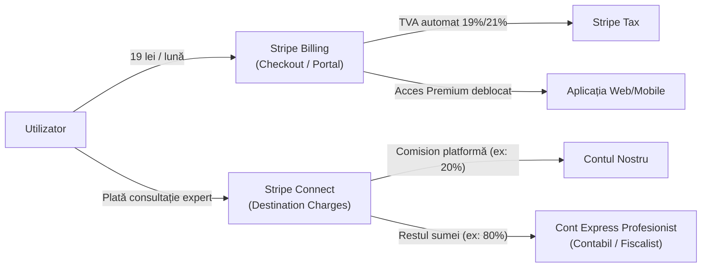

# Modelul de Business: „Ce înseamnă pentru mine”

**Echipa:** Runtime Terror  
**Hackathon:** NEXXT AI × Stripe – „Rethinking Financial Futures” (România), 28–29 octombrie 2026  
**Misiune:** Fiecare lege nouă, tradusă în lei pe lună pentru tine, proactiv și determinist.

---

## 1. Analiza Direcției 1: Modelul pe bază de Abonament (Freemium)

### 1.1 Cum funcționează Biziday în realitate: Verificarea ipotezei organizatorului

* **Verificarea prețului de „15 lei”:**  
  Organizatorul a menționat un abonament de 15 lei „în stilul Biziday”. În realitate, aplicația mobilă **Biziday este 100% gratuită** atât pe [Google Play](https://play.google.com/store/apps/details?id=ro.biziday.app), cât și pe [Apple App Store](https://apps.apple.com/ro/app/biziday/id1183842421). Nu există nicio taxă obligatorie sau paywall lunar în aplicație.
* **Modelul real de venituri Biziday:**  
  Biziday funcționează pe un model editorial independent susținut prin **donații voluntare / susținere comunitară** recurentă sau unică, gestionată pe pagina oficială [biziday.ro/sustine](https://www.biziday.ro/sustine/).  
  Pragurile prestabilite pe site sunt de **20 lei, 50 lei, 100 lei, 250 lei, 500 lei / lună** (sau o sumă personalizată) și opțiuni de donație unică, alături de granturi sau sponsorizări specifice.
* **Numărul de utilizatori și donatori:**  
  Aplicația Biziday a depășit **500.000 de descărcări pe Google Play** (peste 37.000 descărcări în primele 24 de ore de la lansarea din decembrie 2016). Numărul exact al donatorilor plătitori recurenți nu este publicat oficial de către redacție (**TODO** – date financiare publice nedisponibile pe categorii de donatori).
* **De ce plătesc / susțin oamenii „doar știrile absolut necesare”:**  
  1. *Economie masivă de timp și sinteză:* Oamenii plătesc pentru reducerea zgomotului mediatic. Biziday oferă rezumate clare și factualitate direct în titlu, fără clickbait și fără conținut de umplutură.  
  2. *Încredere și independență:* Susținerea unei redacții nealiniate intereselor de partid sau marilor grupuri comerciale.  
  3. *Funcționalități critice de utilitate publică:* Notificările de urgență și alertele de cutremur bazate pe senzorii INFP (Institutul Național de Fizică a Pământului).

---

### 1.2 Propunerea noastră de împărțire: Gratuit vs. Plătit (Freemium)

Aplicația „Ce înseamnă pentru mine” nu este o simplă aplicație de știri, ci un **instrument de decizie financiară personalizată**. Prin urmare, împărțirea valorii trebuie să ofere utilitate de bază tuturor românilor (educație și conștientizare civică), monetizând funcțiile avansate de optimizare și calcul fiscal:

| Funcționalitate | Nivel Gratuit (Free) | Nivel Plătit (Premium / Pro) |
|---|:---:|:---:|
| **Alerte la acte normative noi** | Da (notificări push la promulgare/publicare) | Da (prioritare, cu setări avansate de frecvență) |
| **Explicația pe scurt („Nivelul Zero”)** | Da (limbaj simplu, esența legii) | Da |
| **Link oficial Portal Legislativ / Monitorul Oficial** | Da | Da |
| **Profil personal** | 1 profil simplu (max. 4 etichete de bază: salariat, chirie/proprietate) | Multi-profil (gestionează profilul familiei, părinților sau afacerii) |
| **Calculul exact în lei/lună** | Doar orientativ / interval general | **Da, calcul exact pe veniturile și cheltuielile tale reale** |
| **Bara și ecranul „Planul meu”** | Blocat (previzualizare statică) | **Da, simulare completă 12 luni (fără acțiuni vs. cu acțiuni)** |
| **Monitorizarea termenelor limită** | Doar data din lege | **Alerte active de numărătoare inversă („mai ai 64 de zile”)** |
| **Module fiscale avansate (PFA, SRL micro, Dividende)** | Nu | **Da, scenarii complete de optimizare fiscală (OUG 156/2024, Legea 141/2025)** |
| **Analiză automată documente cu AI** | Nu | **Da, încărcare factură/fluturaș/contract pentru auto-completare etichete** |

---

### 1.3 Prețul propus și justificarea prin comparație de piață

* **Preț propus:** **19 lei / lună** (sau **190 lei / an**, oferind 2 luni gratuite la plata în avans).
* **Comparație cu alte produse și servicii pe piața din România:**
  * **Biziday (donații voluntare):** Prag minim recomandat de 20 lei/lună ([biziday.ro/sustine](https://www.biziday.ro/sustine/)).
  * **Recorder Community:** 4 €/lună (~20 lei) sau 10 €/lună (~50 lei) prin SMS recurent sau card ([recorder.ro/sustine](https://recorder.ro/sustine/)).
  * **AvocatNet.ro Premium:** Pachetele Starter pornesc de la 390 lei + TVA / 6 luni (~65-75 lei/lună), destinate preponderent profesioniștilor și firmelor ([abonament.avocatnet.ro](https://abonament.avocatnet.ro/)).
  * **Ziarul Financiar (ZF Corporate):** 300 €/lună (ediția corporate) sau ~12 €/lună (~60 lei/lună) prin pachete speciale pentru abonații Orange ([zfcorporate.ro](https://zfcorporate.ro/), [orange.ro](https://www.orange.ro)).
  * **Abonamente de consum zilnic (lifestyle/streaming):** Spotify România costă ~24–26 lei/lună, YouTube Premium costă ~26 lei/lună.
* **Justificarea valorii (Return on Investment - ROI):**  
  La 19 lei/lună (228 lei/an), prețul este sub pragul psihologic al unei cafele de specialitate pe lună. Dacă utilizatorul este PFA sau deține un SRL și este alertat să distribuie dividendele înainte de 1 ianuarie 2026 (creșterea cotei de la 10% la 16% prin Legea 141/2025), o economie de 6.000 lei amortizează costul abonamentului pe mai bine de 25 de ani.

---

## 2. Analiza Direcției 2: Comision pe client redirecționat (One-Click Affiliate / CPA & CPL)

### 2.1 Mecanismul de funcționare
Fiecare notificare are o acțiune recomandată. De exemplu, când un card notifică: *„Eliminarea plafonării la gaze de la 31 martie 2027 (OUG 12/2026)”*, butonul de acțiune permite comutarea directă către o ofertă mai avantajoasă de pe piață. Partenerul comercial plătește un comision per client adus (**CPA – Cost per Acquisition**) sau per formular/lead validat (**CPL – Cost per Lead**).

### 2.2 Inventar Parteneri pe Categorii în România

Tabelul complet al partenerilor validați (disponibil și ca fișier de date în [`business/parteneri.json`](file:///C:/Users/andre/Desktop/Examen/runtime-terror-stripe/business/parteneri.json)):

| Categorie | Partener | Pagina oficială de ofertă | Program de afiliere public | Comision estimat / documentat | Sursă |
|---|---|---|:---:|---|---|
| **Energie & Gaz** | Engie România | [engie.ro/gaz-energie](https://www.engie.ro/gaz-energie/) | de negociat | 50 – 150 lei / contract (CPA) sau 15 – 30 lei / lead (CPL) | Parteneriat direct B2B / brokeraj energie |
| **Energie & Gaz** | E.ON România | [eon.ro/.../energie-si-gaz](https://www.eon.ro/persoane-fizice/energie-si-gaz) | de negociat | 50 – 150 lei / contract (CPA) sau 15 – 30 lei / lead (CPL) | Parteneriat direct de achiziție digitală |
| **Energie & Gaz** | PPC Energie (ex-Enel) | [ppcenergy.ro/oferte](https://www.ppcenergy.ro/persoane-fizice/oferte/) | de negociat | 50 – 150 lei / contract nou semnat | Negociere directă de lead gen |
| **Energie & Gaz** | Hidroelectrica | [hidroelectrica.ro](https://www.hidroelectrica.ro/furnizare-energie/) | Nu (0 lei) | 0 lei (furnizor de stat; preț de referință neutru) | Nu practică afiliere |
| **Telecom** | Orange România | [orange.ro/abonamente](https://www.orange.ro/abonamente/) | **2Performant** | 5 – 25 € / abonament sau portare activată | [2Performant Orange](https://2performant.com/affiliate-programs/orange-romania/) |
| **Telecom** | Vodafone România | [vodafone.ro/abonamente](https://www.vodafone.ro/abonamente/) | de negociat | 5 – 20 € / contract (istoric pe 2Performant) | [vodafone.ro](https://www.vodafone.ro/) |
| **Telecom** | Digi (RCS & RDS) | [digi.ro/telefonie-mobila](https://www.digi.ro/servicii/telefonie-mobila) | de negociat | de negociat (canale exclusiv in-house) | [digi.ro](https://www.digi.ro/) |
| **Pensii Pilon III** | NN Pensii | [nn.ro/pensie-facultativa-pilon-3](https://www.nn.ro/pensie-facultativa-pilon-3) | de negociat | de negociat (strict reglementat ASF) | [Legea 204/2006, art. 74^1](https://asfromania.ro/) (*de confirmat cu un jurist*) |
| **Pensii Pilon III** | BCR Pensii (BCR Plus) | [bcr.ro/.../pensie-facultativa-pilon-3](https://www.bcr.ro/ro/persoane-fizice/pensii-private/pensie-facultativa-pilon-3) | de negociat | de negociat (strict reglementat ASF) | [asfromania.ro](https://asfromania.ro/) (*de confirmat cu un jurist*) |
| **Pensii Pilon III** | Allianz-Țiriac Pensii | [allianztiriacpensii.ro](https://www.allianztiriacpensii.ro/produse/pensia-facultativa-pilon-3/) | de negociat | de negociat (strict reglementat ASF) | [asfromania.ro](https://asfromania.ro/) (*de confirmat cu un jurist*) |
| **Pensii Pilon III** | Metropolitan Life | [metropolitanlife.ro](https://www.metropolitanlife.ro/produse/pensie/pensii-facultative-pilon-3/) | de negociat | de negociat (strict reglementat ASF) | [asfromania.ro](https://asfromania.ro/) (*de confirmat cu un jurist*) |
| **Bănci** | BCR (George) | [bcr.ro/.../conturi-si-planuri-george](https://www.bcr.ro/ro/persoane-fizice/conturi-si-planuri-george) | de negociat | 30 – 70 lei / cont activat (CPA) sau 15 – 25 lei / lead | Parteneriat direct / rețele de afiliere pe campanii |
| **Bănci** | Banca Transilvania | [bancatransilvania.ro](https://www.bancatransilvania.ro/persoane-fizice/economii-si-investitii) | de negociat | 30 – 70 lei / cont nou; 15 – 20 lei / lead | Performance marketing direct |
| **Bănci** | ING Bank România | [ing.ro/.../cont-de-economii](https://ing.ro/persoane-fizice/economii-si-investitii/cont-de-economii) | de negociat | 50 – 100 lei / client activat (promoțional) | Campanii promoționale punctuale |
| **Bănci** | CEC Bank | [cec.ro/.../depozite-si-economii](https://www.cec.ro/persoane-fizice/depozite-si-economii) | de negociat | 30 – 60 lei / cont deschis online | Achiziție digitală directă |
| **Asigurări** | Pint.ro (Broker) | [pint.ro](https://www.pint.ro/) | **2Performant** | 0,01% – 3,5% RCA; până la 10% – 15% facultative (PAD, călătorie) | [2Performant Pint.ro](https://2performant.com/affiliate-programs/pint-ro/) |
| **Asigurări** | Asigurari.ro | [asigurari.ro](https://www.asigurari.ro/) | de negociat | 2% – 4% RCA; 10% – 15% călătorie / locuință | Comisioane uzuale brokeraj online |
| **Asigurări** | Allianz-Țiriac Asigurări | [allianztiriac.ro](https://www.allianztiriac.ro/ro_RO/persoane-fizice.html) | de negociat | 5% – 15% pentru polițe facultative | Contract asistent în brokeraj |
| **Asigurări** | Groupama Asigurări | [groupama.ro](https://www.groupama.ro/) | de negociat | 5% – 15% pe polițe non-viață | Parteneriat direct B2B |

---

### 2.3 Riscul de Conflict de Interese: Cum ne păstrăm neutralitatea absolută

Dacă Engie ne plătește 100 lei comision pentru un contract semnat, iar Hidroelectrica oferă un preț/kWh cu 20% mai ieftin dar nu plătește comision, există un risc imens de compromitere a încrederii. Fără încredere, aplicația își pierde rațiunea de a exista.

Pentru a garanta neutralitatea, am definit **5 reguli etice și tehnice inviolabile**:

1. **Afișare comparativă obligatorie (Multi-Provider Rule):**  
   Niciun card de acțiune nu va afișa vreodată un singur buton monopolist. Se vor prezenta întotdeauna minimum 2–3 opțiuni concurente de pe piață, plus comparatorul oficial reglementat (de exemplu, comparatorul de tarife ANRE pentru energie/gaz sau registrul APAPR pentru pensii).
2. **Marcaj vizual transparent și distinctiv:**  
   Orice opțiune comisionată conține eticheta vizibilă `[Partener comercial]` sau `[Link promovat]`, în conformitate cu normele ANPC și Directiva Europeană privind practicile comerciale neloiale (UCPD).
3. **Fără recomandări subiective („No Steering”):**  
   Textele din aplicație rămân pur factuale. Este interzisă folosirea termenilor precum „Cel mai bun furnizor”, „Recomandarea noastră” sau „Garantat”. Formularea este: *„Furnizori activi cu oferte sub nivelul plafonului”*.
4. **Ierarhizare bazată exclusiv pe criterii financiare ale utilizatorului:**  
   Ordinea de afișare a opțiunilor este sortată strict după:
   - Cel mai mic cost / kWh sau cea mai mare dobândă la depozit;
   - Transparența condițiilor contractuale;  
   Mărimea comisionului primit de noi nu are nicio influență în algoritmul de sortare.
5. **Decuplare totală a motorului de calcul:**  
   Suma în lei calculată în notificare este generată determinist pe dispozitivul utilizatorului conform catalogului legislativ public (`data/catalog.json`). Ea nu este modificată sau influențată în niciun mod de existența sau absența unui partener comercial.

---

### 2.4 Cadrul de Reglementare ASF: Pensii Pilon III și Produse de Investiții

> [!CAUTION]
> **Avertisment de conformitate legislativă: de confirmat cu un jurist.**  
> Conform **Legii nr. 204/2006 privind pensiile facultative** (în special **Art. 74^1**), activitatea de marketing a prospectului schemei de pensii facultative (Pilon III) se poate desfășura **exclusiv prin intermediul agenților de marketing autorizați sau avizați de ASF** (Autoritatea de Supraveghere Financiară).

* **Implicații:** O simplă schemă de afiliere nereglementată (redirecționare cu plată per lead/aderare la un fond de Pilon III) este expusă riscului de a fi sancționată de ASF ca intermediere neautorizată de instrumente financiare/pensii private. De asemenea, art. 74^1 alin. (4) interzice acordarea de beneficii colaterale pentru a convinge un participant să adere la un fond.
* **Măsură adoptată de noi:**  
  Pe componenta de Pilon III și investiții, butonul din cardul aplicației oferă **doar trimiteri neutre și necomisionate** către registrul oficial ASF / comparatorul APAPR, până când obținem avizul juridic sau încheiem un parteneriat formal printr-un broker de pensii autorizat ASF.

---

## 3. Arhitectura de Plăți Stripe (Sponsorul Hackathonului)

Pentru a asigura monetizarea fără fricțiuni, folosim componentele native Stripe:

### 3.1 Stripe Billing pentru Gestionarea Abonamentelor
* **Stripe Subscriptions API:** Gestionarea automată a ciclului de viață al abonamentului de 19 lei/lună sau 190 lei/an ([Documentație Stripe Subscriptions](https://stripe.com/docs/billing/subscriptions/overview)).
* **Stripe Checkout:** Flux de plată optimizat pentru conversie rapidă, cu suport nativ pentru carduri bancare, Apple Pay și Google Pay ([Documentație Stripe Checkout](https://stripe.com/docs/payments/checkout)).
* **Stripe Customer Portal:** Pagină securizată unde utilizatorii își pot schimba cardul, descărca facturile fiscale sau anula abonamentul dintr-un singur click, fără ca noi să construim interfață dedicată ([Documentație Stripe Customer Portal](https://stripe.com/docs/customer-management/portal-deep-links)).
* **Stripe Tax:** Calcularea și colectarea automată a TVA-ului pentru România (conform cotelor actualizate din Legea 141/2025: 19% sau 21%) ([Documentație Stripe Tax](https://stripe.com/docs/tax)).
* **Webhooks:** Sincronizarea stării contului pe dispozitiv prin evenimentele `customer.subscription.created`, `invoice.payment_succeeded` și `customer.subscription.deleted` ([Documentație Stripe Webhooks](https://stripe.com/docs/billing/subscriptions/webhooks)).

### 3.2 Stripe Connect pentru Profesioniști (Marketplace de Consultanță)
În catalogul de acte, fiecare modificare complexă are un câmp `"profesionist"` (ex: contabil autorizat CECCAR, consultant fiscal CCF sau avocat). Când un utilizator are nevoie de asistență personalizată (de exemplu, restructurarea microîntreprinderii sale lovită de plafonul de 100.000 EUR din OUG 156/2024):
* **Onboarding prin Stripe Express:** Profesioniștii își deschid un cont conectat de tip **Express**, unde Stripe gestionează verificarea identității (KYC), contul bancar și conformitatea fiscală ([Documentație Stripe Express Accounts](https://stripe.com/docs/connect/express-accounts)).
* **Destination Charges cu Application Fee:** Utilizatorul plătește ședința de consultanță (ex: 200 lei). Stripe debitează utilizatorul, transferă automat 80% (160 lei) în contul profesionistului și reține un comision de platformă de 20% (40 lei) pentru „Ce înseamnă pentru mine” ([Documentație Stripe Charges](https://stripe.com/docs/connect/charges)).
* **Plăți automate în RON:** Viramente bancare automate SEPA/locale în conturile profesioniștilor români ([Documentație Stripe Payouts](https://stripe.com/docs/connect/payouts)).

---

## 4. Unit Economics: Modelul Financiar

### 4.1 Formula de Calcul a Venitului Mediu per Utilizator per Lună (ARPU)

$$\text{ARPU} = (\text{Preț Abonament} \times \text{Rată Conversie Paid}) + (\text{Comision Mediu CPA} \times \text{Rată Click} \times \text{Rată Conversie Afiliere})$$

### 4.2 Ipotezele de Calcul și Sursele

Fiecare cifră este fundamentată pe surse publice de piață sau marcată ca estimare / TODO:

| Variabilă | Valoare asumată | Justificare / Sursă |
|---|:---:|---|
| **Preț Abonament Premium** | 19 lei / lună | Propunerea noastră; sub media serviciilor similare din România |
| **Rata de conversie Free $\to$ Paid** | 2,5% | Conservator. Media benchmark pentru aplicații mobile/web freemium din categoria *Personal Finance & Productivity* este 2,0% – 4,0% ([Statista Freemium Conversion Benchmark](https://www.statista.com/); Spotify raportează ~2,5% conversie directă freemium fără promoții agresive) |
| **Comision mediu per acțiune afiliată (CPA mediu)** | 60 lei | Media ponderată a acțiunilor: energie/gaz (~80 lei), telecom (~45 lei), conturi bancare (~50 lei), asigurări (~30 lei) (Sursă: programele 2Performant și comisioanele tipice din `business/parteneri.json`) |
| **Frecvența oportunităților relevante per utilizator** | 0,25 / lună | Corespunde la 3 evenimente legislative majore pe an cu acțiune directă de piață per utilizator (estimare conservatoare bazată pe ritmul modificărilor fiscale din România 2025–2026) |
| **Rata de click pe acțiune (CTR)** | 8,0% | Click pe butonul de acțiune din notificare. Mult superioară bannerelor clasice (sub 1%), fiind o notificare personalizată pe etichetele proprii. |
| **Rata de conversie a click-ului la partener** | 2,3% | Sursă directă: [Rapoartele oficiale 2Performant România](https://2performant.com/) indică o rată medie de conversie în rețea de **2,0% – 2,6%** (2,3% medie) |
| **Cost marginal de infrastructură per utilizator** | < 0,02 lei / lună | Arhitectură local-first: calculul și profilul rulează pe telefonul utilizatorului; descărcarea catalogului JSON static consumă sub 1 MB/lună pe Vercel CDN |

### 4.3 Calculul Efectiv

1. **Venit lunar din Abonament per utilizator:**  
   $$V_{\text{abonament}} = 19\text{ lei} \times 2,5\% = 0,475\text{ lei / utilizator / lună}$$

2. **Venit lunar din Comisioane per utilizator:**  
   $$\text{Click-uri lunare per utilizator} = 0,25 \times 8,0\% = 0,02\text{ click-uri / lună}$$  
   $$V_{\text{comisioane}} = 60\text{ lei} \times 0,02 \times 2,3\% = 0,0276\text{ lei / utilizator / lună}$$

3. **ARPU Total estimat:**  
   $$\text{ARPU Total} = 0,475 + 0,0276 \approx \mathbf{0,50\text{ lei / utilizator / lună}}\quad (\approx 6,00\text{ lei / utilizator / an})$$

### 4.4 Proiecție Financiară la Scară (100.000 Utilizatori Activi)

* **Utilizatori activi:** 100.000
* **Abonați plătitori (2,5%):** 2.500 utilizatori $\times$ 19 lei = **47.500 lei / lună**
* **Venit din comisioane afiliate:** 100.000 $\times$ 0,0276 lei = **2.760 lei / lună**
* **Venit Total Lunar:** **50.260 lei / lună** (~10.050 EUR / lună)
* **Venit Total Anual:** **603.120 lei / an** (~120.600 EUR / an)
* **Ponderea veniturilor:** **94,5% din abonamente recurente**, **5,5% din comisioane afiliate**.
* **Marjă brută:** **> 90%**, datorită rulării locale a calculului pe dispozitiv și absenței costurilor mari de backend/API pe interogare.

---

## 5. Recomandarea Strategică

Recomandăm **un model hibrid asimetric, având Abonamentul Freemium drept pilon central absolut (Core)** și **Comisioanele One-Click exclusiv ca serviciu de conveniență utilitară (Secondary)**:

1. **Independența este produsul:**  
   Valoarea fundamentală a aplicației este încrederea că alerta este obiectivă și calculată strict pentru binele financiar al utilizatorului. Dacă modelul ar depinde majoritar de comisioanele furnizorilor de energie sau băncilor, utilizatorul ar suspecta că legile sunt împachetate pentru a genera lead-uri comerciale.
2. **Stabilitate financiară prin Stripe Billing:**  
   Abonamentul recurent oferă predictibilitate lunară (MRR), în timp ce comisioanele de afiliere sunt volatile și dependente de campaniile sezoniere ale advertiserilor.
3. **Imunitate la riscuri de reglementare:**  
   Abonamentul perceput pentru sinteză de date publice și calcul educațional nu necesită licențiere BNR sau autorizare ASF. Redirecționările plătite către produse financiare (Pilon III, credite) presupun bariere legale semnificative și costuri de conformitate.
4. **Extindere viitoare (Marketplace B2B2C prin Stripe Connect):**  
   Următorul pas natural de monetizare nu sunt reclamele, ci intermedierea consultanței calificate: punerea în legătură a utilizatorului afectat de o lege complexă cu un contabil sau consultant fiscal partener, taxând 15–20% comision de platformă prin Stripe Connect.
