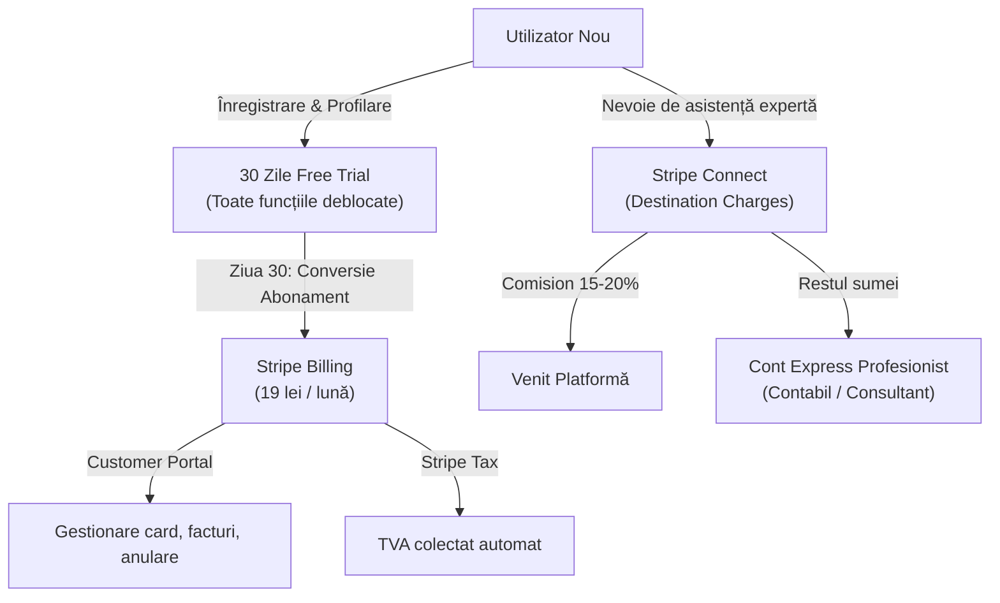

# Modelul de Business: „Ce înseamnă pentru mine”

**Echipa:** Runtime Terror  
**Hackathon:** NEXXT AI × Stripe – „Rethinking Financial Futures” (România), 28–29 octombrie 2026  
**Misiune:** Fiecare lege nouă, tradusă în lei pe lună pentru tine, proactiv, determinist și cu neutralitate absolută.

---

## 1. Direcția 1: Modelul pe bază de Abonament (Trial de 1 lună $\to$ Paid)

### 1.1 De ce NU facem Freemium perpetuu: Analiza Biziday și Realitatea Pieței

Organizatorul a sugerat un model de abonament de 15 lei „în stilul Biziday”. Înainte de a stabili arhitectura noastră comercială, am analizat factual cum funcționează Biziday:

* **Biziday în realitate:**  
  Aplicația mobilă **Biziday este 100% gratuită** pe [Google Play](https://play.google.com/store/apps/details?id=ro.biziday.app) (peste 500.000 de descărcări) și [Apple App Store](https://apps.apple.com/ro/app/biziday/id1183842421). Nu există niciun abonament de 15 lei și niciun paywall obligatoriu în aplicație.
* **Cum se finanțează Biziday:**  
  Biziday este susținută exclusiv prin **donații voluntare** ale comunității pe pagina oficială [biziday.ro/sustine](https://www.biziday.ro/sustine/) (cu praguri sugerate de 20 lei, 50 lei, 100 lei, 250 lei, 500 lei/lună sau donație unică), alături de granturi și sponsorizări. Numărul exact al donatorilor lunari este nepublicat (**TODO**).
* **De ce susțin oamenii Biziday:**  
  Fără clickbait, sinteză la obiect (economie uriașă de timp), independență față de trusturi politice și alerte critice (cutremur INFP).

#### Decizia Noastră Strategică: Fără Model Free Perpetuu, doar Free Trial de 1 lună

Aplicația „Ce înseamnă pentru mine” nu este un canal media generalist, ci un **instrument financiar de precizie** care aduce economii directe în buzunarul fiecărui român.

1. **De ce renunțăm la freemium permanent:**  
   Un nivel gratuit perpetuu atrage utilizatori pasivi, diluează percepția de valoare și obligă fondatorii să caute monetizări colaterale (reclame sau parteneriate compromise).
2. **Ce include Trial-ul de 1 lună (30 de zile):**  
   Fiecare utilizator nou beneficiază de o lună complet gratuită, care acoperă:
   - **Conceperea și configurarea contului:** Onboarding complet prin dialog cu asistentul AI sau formular rapid;
   - **Identificarea celor 6 familii de etichete:** Cum câștigi, ce deții, cine depinde de tine, ce conduci, unde locuiești, domeniul tău;
   - **Acces nerestricționat la motorul de calcul:** Calculul exact al impactului în lei/lună pentru toate actele din Monitorul Oficial;
   - **Ecranul „Planul meu”:** Comparația pe 12 luni fără acțiuni vs. cu acțiuni alese și numărătoarea inversă pentru termene limită;
   - **Simulări interactive:** Comutatoare active pe fiecare acțiune.
3. **Ce se întâmplă după cele 30 de zile de Trial:**  
   După prima lună (în care utilizatorul a văzut exact câți bani pierde sau câștigă din modificările fiscale), aplicația solicită activarea abonamentului pentru a continua să primească alerte la legile viitoare și pentru a menține recalcularea dinamică a planului financiar.

---

### 1.2 Prețul Abonamentului și Justificarea prin ROI

* **Preț:** **19 lei / lună** (sau **190 lei / an**, cu 2 luni incluse gratuit la plata anuală).
* **Comparație de piață în România:**
  * **Biziday (donație voluntară):** Prag minim recomandat de 20 lei/lună ([biziday.ro/sustine](https://www.biziday.ro/sustine/)).
  * **Recorder Community:** 4 €/lună (~20 lei) sau 10 €/lună (~50 lei) prin SMS recurent sau card ([recorder.ro/sustine](https://recorder.ro/sustine/)).
  * **AvocatNet.ro Premium:** Abonamentele Starter pornesc de la 390 lei + TVA / 6 luni (~65–75 lei/lună echivalent) ([abonament.avocatnet.ro](https://abonament.avocatnet.ro/)).
  * **Ziarul Financiar (Corporate):** 300 €/lună sau ~12 €/lună (~60 lei) prin parteneriat Orange ([zfcorporate.ro](https://zfcorporate.ro/)).
  * **Abonamente de consum zilnic:** Spotify România (~24–26 lei/lună), YouTube Premium (~26 lei/lună).
* **Rentabilitatea Investiției (ROI):**  
  La 19 lei/lună (228 lei/an), o singură acțiune sugerată de aplicație (de pildă, scoaterea dividendelor înainte de majorarea cotei de la 10% la 16% prin Legea 141/2025, sau schimbarea contractului de gaz înainte de expirarea plafonării din OUG 12/2026) generează economii de la câteva sute la mii de lei, acoperind costul pe 5–10 ani.

---

## 2. Direcția 2: Redirecționarea One-Click & Neutralitatea Radicală

### 2.1 Principiul Fondator: Nu facem parteneriate directe ca să nu fim părtinitori (No Bias)

Dacă am negocia comisioane directe (B2B) cu Engie, PPC sau o anumită bancă:
- Am deveni captivi interesului lor comercial;
- Am fi tentați să afișăm partenerul care plătește cel mai mare comision, nu pe cel care are cel mai mic preț pentru cetățean;
- Utilizatorul ar pierde încrederea în independența calculului nostru.

**Regula noastră de integritate:**
> **Nu negociem parteneriate directe.** Pentru a ne păstra credibilitatea absolută, apelăm exclusiv la companiile care au deja programe publice de afiliere pe rețeaua deschisă **2Performant**. Pentru toate companiile care NU au afiliere pe 2Performant (inclusiv furnizorii cu cele mai bune tarife, cum este Hidroelectrica), **trimitem utilizatorii direct și 100% gratuit, fără ca noi să încasăm niciun ban.**

### 2.2 Cum funcționează algoritmul de redirecționare:

1. **Recomandarea se face strict după interesul utilizatorului:**  
   Sortarea opțiunilor în ecranul de acțiune este determinată exclusiv de preț/cost (cel mai mic preț pe kWh la gaz/curent, cele mai mici comisioane bancare, cel mai mare randament).
2. **Monetizare pasivă doar prin 2Performant:**  
   Dacă oferta optimă aparține unui brand prezent pe 2Performant (ex: Orange în telecom sau Pint.ro la asigurări), aplicația atașează automat linkul de afiliere public pentru a încasa comisionul standard al platformei.
3. **Trimitere pro-bono pentru restul pieței:**  
   Dacă oferta optimă este la Hidroelectrica, Engie, o bancă de stat (CEC Bank) sau un fond de pensii fără afiliere pe 2Performant, butonul one-click duce direct pe pagina oficială a furnizorului, cu link curat, necomisionat. **Câștigăm 0 lei, dar ne păstrăm 100% credibilitatea.**

---

### 2.3 Tabelul Partenerilor pe Categorii (2Performant vs. Pro-Bono)

Structura detaliată din fișierul de date [`business/parteneri.json`](file:///C:/Users/andre/Desktop/Examen/runtime-terror-stripe/business/parteneri.json):

| Categorie | Brand | URL Ofertă Oficială | Mecanism Afiliere | Comision Încasat de Noi | Notă Integritate |
|---|---|---|:---:|:---:|---|
| **Energie & Gaz** | **Hidroelectrica** | [hidroelectrica.ro](https://www.hidroelectrica.ro/furnizare-energie/) | **Fără afiliere (pro-bono)** | **0 lei** | **Cel mai mic preț la energie; trimitere 100% gratuită** |
| **Energie & Gaz** | Engie România | [engie.ro/gaz-energie](https://www.engie.ro/gaz-energie/) | Fără afiliere (pro-bono) | 0 lei | Trimitere directă pe oferta Celsius / OUG 12/2026 |
| **Energie & Gaz** | E.ON România | [eon.ro/.../energie-si-gaz](https://www.eon.ro/persoane-fizice/energie-si-gaz) | Fără afiliere (pro-bono) | 0 lei | Trimitere directă gratuită |
| **Energie & Gaz** | PPC Energie | [ppcenergy.ro/oferte](https://www.ppcenergy.ro/persoane-fizice/oferte/) | Fără afiliere (pro-bono) | 0 lei | Trimitere directă gratuită |
| **Telecom** | **Orange România** | [orange.ro/abonamente](https://www.orange.ro/abonamente/) | **2Performant** | **5 – 25 € / contract** | [Program public 2Performant](https://2performant.com/affiliate-programs/orange-romania/) |
| **Telecom** | Vodafone România | [vodafone.ro/abonamente](https://www.vodafone.ro/abonamente/) | Fără afiliere (pro-bono) | 0 lei | Trimitere directă gratuită |
| **Telecom** | Digi (RCS & RDS) | [digi.ro/telefonie-mobila](https://www.digi.ro/servicii/telefonie-mobila) | Fără afiliere (pro-bono) | 0 lei | Trimitere directă gratuită |
| **Asigurări** | **Pint.ro (Broker)** | [pint.ro](https://www.pint.ro/) | **2Performant** | **0,01% – 3,5% RCA; 10%–15% facultative** | [Program public 2Performant](https://2performant.com/affiliate-programs/pint-ro/) |
| **Asigurări** | Asigurari.ro | [asigurari.ro](https://www.asigurari.ro/) | Fără afiliere (pro-bono) | 0 lei | Trimitere directă gratuită |
| **Asigurări** | Allianz-Țiriac | [allianztiriac.ro](https://www.allianztiriac.ro/ro_RO/persoane-fizice.html) | Fără afiliere (pro-bono) | 0 lei | Trimitere directă gratuită |
| **Asigurări** | Groupama | [groupama.ro](https://www.groupama.ro/) | Fără afiliere (pro-bono) | 0 lei | Trimitere directă gratuită |
| **Bănci** | BCR (George) | [bcr.ro/.../conturi-si-planuri-george](https://www.bcr.ro/ro/persoane-fizice/conturi-si-planuri-george) | Fără afiliere (pro-bono) | 0 lei | Trimitere directă gratuită |
| **Bănci** | Banca Transilvania | [bancatransilvania.ro](https://www.bancatransilvania.ro/persoane-fizice/economii-si-investitii) | Fără afiliere (pro-bono) | 0 lei | Trimitere directă gratuită |
| **Bănci** | ING Bank | [ing.ro/.../cont-de-economii](https://ing.ro/persoane-fizice/economii-si-investitii/cont-de-economii) | Fără afiliere (pro-bono) | 0 lei | Trimitere directă gratuită |
| **Bănci** | CEC Bank | [cec.ro/.../depozite-si-economii](https://www.cec.ro/persoane-fizice/depozite-si-economii) | Fără afiliere (pro-bono) | 0 lei | Trimitere directă gratuită |
| **Pilon III** | NN Pensii | [nn.ro/pensie-facultativa-pilon-3](https://www.nn.ro/pensie-facultativa-pilon-3) | Fără afiliere (pro-bono) | 0 lei | Trimitere pur educativă / reglementată |
| **Pilon III** | BCR Pensii | [bcr.ro/.../pensie-facultativa-pilon-3](https://www.bcr.ro/ro/persoane-fizice/pensii-private/pensie-facultativa-pilon-3) | Fără afiliere (pro-bono) | 0 lei | Trimitere pur educativă / reglementată |
| **Pilon III** | Allianz-Țiriac Pensii | [allianztiriacpensii.ro](https://www.allianztiriacpensii.ro/produse/pensia-facultativa-pilon-3/) | Fără afiliere (pro-bono) | 0 lei | Trimitere pur educativă / reglementată |
| **Pilon III** | Metropolitan Life | [metropolitanlife.ro](https://www.metropolitanlife.ro/produse/pensie/pensii-facultative-pilon-3/) | Fără afiliere (pro-bono) | 0 lei | Trimitere pur educativă / reglementată |

---

### 2.4 Cadrul Legal ASF: Pensii Pilon III și Investiții

> [!CAUTION]
> **Aspect critic de reglementare: de confirmat cu un jurist.**  
> Conform **Legii nr. 204/2006 privind pensiile facultative** (**Art. 74^1**), activitatea de marketing a prospectului schemelor de pensii facultative este rezervată **exclusiv agenților de marketing autorizați sau avizați de ASF**. Este interzisă intermedierea comercială sau acordarea de foloase colaterale pentru aderarea la un fond.

* **Concluzie:** În aplicație, orice trimitere către Pilonul III rămâne **strict neutră, pro-bono și educativă** (link către pagina administratorului sau registrul APAPR/ASF), fără niciun mecanism de comisionare comercială.

---

## 3. Implementarea Tehnică cu Stripe (Sponsorul Challenge-ului)

### 3.1 Stripe Billing pentru Gestionarea Trial-ului și a Abonamentului
* **Configurare Free Trial nativ:**  
  Folosim parametrul `subscription_data.trial_period_days: 30` în API-ul Stripe Subscriptions ([stripe.com/docs/billing/subscriptions/overview](https://stripe.com/docs/billing/subscriptions/overview)). Utilizatorul are acces complet timp de o lună.
* **Stripe Checkout:**  
  Checkout securizat cu Apple Pay, Google Pay și card bancar ([stripe.com/docs/payments/checkout](https://stripe.com/docs/payments/checkout)).
* **Stripe Customer Portal:**  
  Self-service complet pentru utilizatori (actualizare metodă de plată, descărcare facturi, anulare fără fricțiuni) ([stripe.com/docs/customer-management/portal-deep-links](https://stripe.com/docs/customer-management/portal-deep-links)).
* **Stripe Tax:**  
  Gestiune fiscală automată pentru cotele de TVA din România ([stripe.com/docs/tax](https://stripe.com/docs/tax)).
* **Webhooks:**  
  Monitorizarea evenimentelor `customer.subscription.trial_will_end` (trimitere notificare cu 3 zile înainte de expirarea trial-ului) și `invoice.payment_succeeded` ([stripe.com/docs/billing/subscriptions/webhooks](https://stripe.com/docs/billing/subscriptions/webhooks)).

### 3.2 Stripe Connect pentru Profesioniști (Marketplace de Consultanță)
În catalogul de acte, când o lege impune o acțiune tehnică complexă (câmpul `"profesionist"`: contabil CECCAR, consultant fiscal CCF):
* Profesioniștii sunt onboardați prin **Stripe Express Accounts** ([stripe.com/docs/connect/express-accounts](https://stripe.com/docs/connect/express-accounts)), unde Stripe gestionează verificarea identității (KYC) și contul IBAN.
* Plățile pentru consultații se procesează prin **Destination Charges** ([stripe.com/docs/connect/charges](https://stripe.com/docs/connect/charges)), unde aplicația reține un comision de platformă (*Application Fee*, ex: 15–20%), iar diferența este transferată instant profesionistului prin virament SEPA ([stripe.com/docs/connect/payouts](https://stripe.com/docs/connect/payouts)).

---

## 4. Unit Economics: Modelul Financiar

### 4.1 Formula de Calcul (Model Trial $\to$ Paid + Afiliere Pasivă 2Performant)

Venitul mediu lunar per utilizator activ pe platformă (ARPU):

$$\text{ARPU} = (\text{Preț Abonament} \times \text{Rată Conversie Trial-to-Paid}) + (\text{Comision Mediu 2P} \times \text{Pondere Categorii 2P} \times \text{Rată Click} \times \text{Rată Conversie 2P})$$

### 4.2 Ipotezele de Calcul și Sursele

| Parametru | Valoare | Sursă / Justificare |
|---|:---:|---|
| **Preț Abonament după Trial** | 19 lei / lună | Valoare fixată; sub media pieței |
| **Durată Free Trial** | 30 zile | Conceperea contului, asistent AI și acces complet |
| **Rata de conversie Trial $\to$ Paid** | 12,0% | Benchmark industrie SaaS B2C pentru free trial fără card cerut la start (10% – 15% medie; [Recurly Subscription Benchmark Report](https://recurly.com/); dacă se cere card la start, rata crește la 35%–45%) |
| **Comision mediu per acțiune 2Performant** | 45 lei | Media ponderată între contractele Orange și polițele Pint.ro (Sursă: [2Performant](https://2performant.com/)) |
| **Ponderea acțiunilor eligibile pe 2Performant** | 15% | Doar ~15% din acțiunile din catalog au acoperire pe 2Performant (Orange, Pint.ro); restul de 85% (energie, bănci, Pilon III) sunt **100% necomisionate (pro-bono)** |
| **Frecvența oportunităților per utilizator** | 0,25 / lună | Corespunde la 3 evenimente legislative relevante pe an per utilizator |
| **Rata de click pe acțiune (CTR)** | 8,0% | Notificare ultra-personalizată în funcție de profilul local |
| **Rata de conversie a click-ului pe 2Performant** | 2,3% | Sursă directă: Rata medie de conversie în rețeaua [2Performant România](https://2performant.com/) este de **2,0% – 2,6%** |
| **Cost marginal de infrastructură per utilizator** | < 0,02 lei / lună | Rulare locală (local-first pe telefon), descărcare catalog static JSON pe CDN |

### 4.3 Calculul Efectiv

1. **Venit lunar din Abonament:**  
   $$V_{\text{abonament}} = 19\text{ lei} \times 12,0\% = \mathbf{2,28\text{ lei / utilizator / lună}}$$

2. **Venit lunar din Afiliere Pasivă 2Performant:**  
   $$\text{Click-uri lunare cu link 2Performant} = 0,25 \times 15\% \times 8,0\% = 0,003\text{ click-uri / lună}$$  
   $$V_{\text{afiliere}} = 45\text{ lei} \times 0,003 \times 2,3\% = \mathbf{0,0031\text{ lei / utilizator / lună}}$$

3. **ARPU Total Estimativ:**  
   $$\text{ARPU Total} \approx 2,28 + 0,0031 \approx \mathbf{2,28\text{ lei / utilizator / lună}}\quad (\approx 27,40\text{ lei / an})$$

### 4.4 Structura Veniturilor și Concluzia Financiară

La o bază activă de **50.000 de utilizatori** care parcurg sau au finalizat onboarding-ul:
* **Abonați activi plătitori (12%):** 6.000 abonați $\times$ 19 lei = **114.000 lei / lună** (~22.800 EUR / lună);
* **Venit din comisioane 2Performant:** ~155 lei / lună;
* **Ponderea abonamentelor în total venituri:** **99,86%**.

---

## 5. Concluzie și Recomandare Strategică

Modelul rezultat este curat, robust și etic:

1. **Abonamentul este 99%+ din afacere:**  
   Utilizatorul este singurul nostru client real. Nu depindem de bunăvoința furnizorilor de energie, a băncilor sau a companiilor de telecomunicații.
2. **Neutralitatea absolută protejează încrederea:**  
   Trimițând oamenii gratuit la Hidroelectrica sau CEC Bank dacă acolo au cel mai bun preț, câștigăm un capital uriaș de credibilitate publică. Comisioanele 2Performant sunt doar o optimizare oportunistă pe linkurile deja existente public.
3. **Conversie naturală generată de valoarea din Trial:**  
   În cele 30 de zile de probă, utilizatorul își construiește profilul și vede exact câți bani îi sunt protejați. Trecerea la 19 lei/lună este o decizie matematică elementară pentru oricine vrea să-și apere bugetul personal sau afacerea într-un context de volatilitate fiscală extremă.
